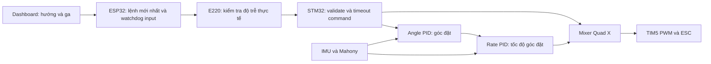

# Rà soát code và đề xuất điều khiển drone sáu hướng

Ngày rà soát: 16/10/2026. Đối chiếu cuối với commit `7f2d24e` (`adjust pid`).

**Kết luận:** đã có nền ổn định tư thế bằng hai vòng PID, nhưng chưa có đường truyền góc đặt để điều khiển hướng. Có thể bổ sung lệnh góc nghiêng và ga vào kiến trúc hiện tại. Nhịp radio đang dùng phù hợp thử chậm trên bàn; chưa đáp ứng điều khiển bay liên tục. Lên/xuống hiện là điều chỉnh ga thủ công, chưa phải giữ độ cao.

File này là báo cáo và các đoạn code để xem xét, **chưa tích hợp vào chương trình**. Toàn bộ snippet phía dưới dành cho thử nghiệm khi tháo cánh. Các giới hạn góc/tốc độ và thời gian là thông số đề xuất, chưa được kiểm chứng trên drone.

## 1. Phạm vi và mức độ xác minh

Đã đọc luồng ứng dụng STM32, driver tự viết, ESP32/dashboard, MSP/IRQ, USB App/Target, cấu hình timer/UART/DMA và danh sách nguồn build. Thư viện HAL/CMSIS/USB của nhà cung cấp chỉ được đối chiếu ở các API liên quan; đây không phải kiểm toán từng dòng thư viện bên thứ ba. Các sketch thử riêng và thư mục backup không phải đường điều khiển STM32 đang chạy.

Không chạy build, flash, gửi lệnh radio hoặc kiểm tra motor. Không thể kết luận về chiều motor, cách gắn IMU, chất lượng RF hoặc khả năng bay chỉ từ source. Số dòng là mốc của bản rà soát; nên tìm thêm theo tên hàm nếu file được định dạng lại.

| Khối | Trạng thái trong code hiện tại |
| --- | --- |
| `main.c` | Khởi tạo IMU, hiệu chuẩn gyro, lấy tư thế ban đầu, chạy PID và PWM |
| `icm42670.c`, `mahony.c` | Đọc gyro/accel, trừ bias, ước lượng góc; chưa có tham chiếu yaw tuyệt đối |
| `angle_controller.c`, `rate_controller.c`, `pid.c` | Vòng góc tạo tốc độ góc đặt; vòng tốc độ tạo hiệu chỉnh motor |
| `mixer.c` | Quad X, giới hạn từng motor 1000–1700 µs |
| `drone_link.c`, `e220.c` | Nhận T/P/G, timeout ga, phản hồi S/A/N/R qua UART DMA |
| ESP32 `.ino` và `index_html.h` | Dashboard ga, đọc/ghi PID, hiển thị telemetry; chưa có điều khiển hướng |
| `gps.c`, `mmc5983ma.c` | Có driver nhưng chưa được bật trong luồng main hiện tại |
| `position_controller.h`, `velocity_controller.h` | Chỉ có struct PID north/east; chưa có implementation hoặc vòng điều khiển |
| `dshot.c`, `e22.c` | Module riêng chưa được main sử dụng; đầu ra đang là PWM, không phải DShot |
| USB CDC | Có enumerate/nhận dữ liệu nhưng chưa parse lệnh điều khiển drone |

## 2. Các phát hiện cần ưu tiên

### 2.1. Cao: độ trễ lệnh và timeout hiện tại quá dài cho lái trực tiếp

Trong `Core/esp32_drone_web/esp32_drone_web.ino:39–47`:

- Gửi T bình thường mỗi **1500 ms**.
- Khoảng nghỉ giữa lần phát ít nhất **900 ms**.
- Heartbeat T giữa các giao dịch PID là **2500 ms**.
- Một lần chờ ACK PID có thể kéo dài **2200 ms**.

`Core/Inc/drone_link.h:22` đặt timeout STM32 **4500 ms**. Khi mất liên lạc, drone có thể tiếp tục lệnh ga trước đó đến khi quá hạn. Thêm nút tiến/lùi mà giữ các thời gian này sẽ tạo điều khiển chậm.

Nút ga 1000 cũng chưa có ưu tiên riêng: API đánh dấu gửi lại ở `.ino:645–647`, nhưng `.ino:534–535` vẫn có thể return vì đang chờ PID. Đây là hạn chế cụ thể của đường lệnh dừng hiện tại.

Chỉ T làm mới `last_throttle_ms` (`drone_link.c:155–156`); P/G không làm mới watchdog. Việc đang trao đổi PID không chứng minh lệnh điều khiển còn mới. Tùy thời điểm chờ ACK, lịch heartbeat 2500 ms cộng chờ 2200 ms còn có thể vượt watchdog 4500 ms.

### 2.2. Cao: khi chu kỳ quá dài, PID trả 0 nhưng main vẫn có thể giữ ga

`main.c:348–355` tính dt bằng `HAL_GetTick()` và chỉ bỏ chu kỳ dưới 2 ms. `pid.c:61–64` reset PID, trả 0 nếu dt lớn hơn 10 ms. Tuy nhiên main vẫn cập nhật Mahony và có thể gọi `Mixer_QuadX(throttle, 0, 0, 0, ...)` khi ga còn cao (`main.c:377–414`).

Đây là đường lỗi mất hiệu chỉnh tư thế tạm thời khi vòng điều khiển bị trễ, chưa phải bằng chứng lỗi đang xảy ra trên board. Cần đo dt min/max và xử lý quá hạn trước estimator/output.

### 2.3. Cao: xử lý lỗi IMU đã có, nhưng chưa bao phủ độ trễ và mẫu lỗi

`main.c:359–370` **đã** đưa bốn motor về 1000 khi hàm đọc IMU báo lỗi. Tuy nhiên `icm42670.c:113–115` dùng SPI blocking với timeout 100 ms mỗi lời gọi; PWM cũ còn tồn tại trong lúc đợi hàm trả về.

`icm42670.c:211–253` chỉ xác nhận giao dịch SPI thành công rồi chuyển đổi số. Chưa kiểm tra data-ready/tuổi mẫu hoặc tình trạng dữ liệu bất thường. SPI báo HAL_OK không chứng minh cảm biến đang đưa mẫu mới, hợp lý. Mahony cũng chưa giảm trọng số accel khi có gia tốc tịnh tiến (`mahony.c:150–177`).

### 2.4. Cao: lỗi CPU chưa có đường xử lý riêng cho motor

`stm32g4xx_it.c:107–164` lặp vô hạn khi fault; `main.c:1119–1127` tắt ngắt rồi lặp. Các nhánh này chưa đổi CCR hoặc tắt TIM5. Nếu lỗi xảy ra khi motor đang chạy, PWM phần cứng có thể tiếp tục xung cũ. Chưa thấy IWDG/WWDG được khởi tạo trong main; module tương ứng cũng chưa bật trong HAL config.

Đây là vấn đề riêng với fault/hang CPU, khác với timeout radio đã có. Cần thiết kế xử lý ở mức timer/watchdog trước khi đánh giá firmware cho bay.

### 2.5. Cao khi ghép điều hướng: phải xác minh hệ trục trước

`mixer.c:61–64` ghi `roll+ = rear down`, `pitch+ = right down`, `yaw+ = CCW`. Công thức trộn khớp comment đó, nhưng tên roll/pitch đang khác cách gọi thường dùng theo thân drone. Không thể tự mặc định pitch là tiến/lùi trong bản code này. Bảng hướng ở mục 4 chỉ đúng nếu phần cứng khớp comment mixer.

### 2.6. Trung bình: dashboard có thể ghi đè gain thật

`esp32_drone_web.ino:58–63` chứa gain mặc định khác STM32. `setup()` hiện không tự gọi đọc PID, dù `DRONE_LINK_PROTOCOL.md:20` nói có. Nút Apply tại `index_html.h:98–100` gửi **cả 15 gain**.

Vì vậy nên đọc đủ năm PID từ STM32 trước khi sửa/gửi; cần thêm cờ đã đọc đủ để chặn Apply khi chưa có dữ liệu thật. Ghi PID đang chạy còn gọi `PID_Reset()` (`drone_link.c:181–184`), gây bước thay đổi trạng thái điều khiển. Đề xuất chỉ đọc/ghi PID khi đang thử ở ga tối thiểu.

Thông số **hiện tại** đã khác các bản trước:

| PID | Kp | Ki | Kd | integral_limit | output_limit |
| --- | ---: | ---: | ---: | ---: | ---: |
| Angle Roll | 7.2 | 0.015 | 0.001 | 10 | 200 |
| Angle Pitch | 7.2 | 0.015 | 0 | 10 | 200 |
| Rate Roll | 0.8 | 0.02 | 0.007 | 10 | 180 |
| Rate Pitch | 0.8 | 0.002 | 0.007 | 10 | 180 |
| Rate Yaw | 0.3 | 0 | 0 | 0 | 100 |

Nguồn: `angle_controller.c:19–25`, `rate_controller.c:20–30`. I hiện được phép hoạt động trên roll/pitch vì giới hạn là 10; không còn cơ sở nói I bị khóa trên bốn PID đó. Yaw I vẫn bằng 0.

### 2.7. Trung bình: chưa kiểm tra đầy đủ thứ tự và tuổi lệnh

`drone_link.c:148–159` chỉ dùng seq để echo, không chống T cũ/lặp/đảo thứ tự. Lệnh ga cao đến trễ sau ga 1000 vẫn có thể được nhận. `Poll()` kiểm timeout trước khi đọc FIFO rồi gắn thời gian parse mới cho T tồn đọng (`:220–247`).

ESP32 cũng chưa đối chiếu seq S với yêu cầu T để quyết định freshness (`.ino:409–430`). Status cũ nhưng hợp lệ vẫn có thể làm mới trạng thái link.

Parser dùng `strtok` bỏ qua trường rỗng: ví dụ payload `T,1,,1200` có thể được hiểu như `T,1,1200`. Hàm `parse_u32` còn chưa kiểm `errno` khi `strtoul` tràn miền unsigned long 32 bit. Snippet C bên dưới dùng cách tách trường giữ nguyên trường rỗng và kiểm tràn số riêng.

Seq chỉ giúp nhận diện thứ tự, **không chứng minh tuổi của một khung chưa từng được nhận**. Muốn xử lý đầy đủ cần quy ước phiên kết nối/TTL và phục hồi sau reset; snippet tối thiểu chưa giải quyết hết phần này.

### 2.8. Các giới hạn và lỗi khác

- `mixer.c:24–35,89–92`: chặn độc lập từng motor; chưa có phân bổ lại khi bão hòa. Anti-windup PID chưa nhận thông tin motor bị bão hòa. Ga lớn cộng nghiêng/yaw có thể làm mất tỉ lệ moment mong muốn.
- `/api/state` cập nhật `lastWebMs` (`.ino:587–588`) và trang poll mỗi 500 ms. Trang đang mở vẫn duy trì heartbeat, không đồng nghĩa người dùng đang điều khiển hướng. Cần heartbeat lệnh riêng.
- `icm42670.c:251`: đổi nhiệt độ bằng `/132.48`; dữ liệu thanh ghi ICM-42670-P dùng `/128 +25`, theo [datasheet TDK, trang 51](https://product.tdk.com/system/files/dam/doc/product/sensor/mortion-inertial/imu/data_sheet/ds-000451-icm-42670-p.pdf). Lỗi này ảnh hưởng nhiệt độ, không trực tiếp thay đổi PID tư thế.
- `gps.c:173,187`: `strcpy` vào mảng 16 byte có thể tràn nếu trường dài; `strtok` làm mất trường NMEA rỗng; chưa có checksum/tuổi mẫu. GPS chưa bật nên chưa nằm trên luồng bay hiện tại.
- DShot chưa được gọi; TIM5 hiện cấu hình PWM và chưa có DMA motor tương ứng. `DSHOT_Init()` gọi PWM Start còn `DSHOT_Write()` gọi Start_DMA; không thể bật DShot chỉ bằng cách gọi thêm Write. Cần rà lại timer/DMA, trạng thái channel và quy tắc lệnh stop của DShot trước khi dùng.
- USB CDC chưa xử lý lệnh drone. Không nên coi việc có cổng USB là đã có một đường điều khiển dự phòng.

### 2.9. Những phần đã có cơ sở đúng trong source

- E220 sao chép TX vào buffer tồn tại lâu dài, giữ buffer tới callback USART hoàn tất (`e220.c:44–55,87–92`).
- USART2 RX DMA Channel1, TX Channel2 và IRQ hiện khớp. Không thấy lại lỗi mapping TX DMA cũ.
- Log USART1 hiện dùng `HAL_UART_Transmit_IT`; không có `HAL_Delay(50)` trong vòng điều khiển hiện tại.
- Khởi tạo tư thế từ accel, trừ gyro bias, đổi gyro sang rad/s trong Mahony và giới hạn đối số asin đã có.
- PID có kiểm tra input hữu hạn, dt, lọc D trên feedback và giới hạn I/output. Chưa đủ để kết luận gain hiện tại phù hợp phần cứng.

## 3. Phân biệt PWM, PID và chuyển động

TIM5 ở `main.c:810–812` có clock 144 MHz, PSC=143, ARR=2499:

```text
Tick timer = 144 MHz / (143+1) = 1 MHz = 1 µs/count
PWM        = 1 MHz / (2499+1) = 400 Hz
CCR 1000   = HIGH 1000 µs, duty 40%
CCR 1700   = HIGH 1700 µs, duty 68%
```

Vòng PID chạy từ while với ngưỡng 2 ms, danh định tối đa khoảng 500 Hz nếu công việc hoàn thành kịp; không phải PID 400 Hz. Muốn 400 Hz cần lịch 2500 µs và dt đo bằng timer độ phân giải microsecond, không chỉ đổi ngưỡng `HAL_GetTick()` sang 0.0025.

Luồng điều khiển đề xuất:



Không thêm trực tiếp một lượng PWM cố định vào một motor để rẽ; gửi góc đặt để PID tự tạo chênh lệch motor và tiếp tục giữ ổn định.

## 4. Trái/phải, tiến/lùi, lên/xuống trong bản code này

Theo **sơ đồ/comment hiện tại của mixer**, nhìn từ trên xuống:

```text
              MŨI
        M4 CW     M2 CCW
                FC
        M3 CCW    M1 CW
              ĐUÔI
```

| Yêu cầu | Giá trị đặt có điều kiện | Ý nghĩa theo comment mixer |
| --- | --- | --- |
| Tiến | roll_sp âm, pitch_sp=0 | Hạ mũi |
| Lùi | roll_sp dương, pitch_sp=0 | Hạ đuôi |
| Dịch trái | roll_sp=0, pitch_sp âm | Nghiêng trái |
| Dịch phải | roll_sp=0, pitch_sp dương | Nghiêng phải |
| Quay đầu trái | yaw_rate_sp dương | Quay CCW theo comment |
| Quay đầu phải | yaw_rate_sp âm | Quay CW theo comment |
| Lên | Tăng ga tổng | Tăng lực đẩy; còn phụ thuộc ga treo, góc nghiêng và tải |
| Xuống | Giảm ga tổng | Giảm lực đẩy; không phải lệnh hạ cánh tự động |

**Bảng này chưa xác nhận chiều vật lý.** Trước khi dùng tên hướng trên UI, tháo cánh và đối chiếu: trục IMU nào đổi khi hạ mũi, dấu góc/rate, motor nào ở vị trí nào, chiều quay và phản ứng hiệu chỉnh. Nếu không khớp, cần thống nhất phép biến đổi trục cho cả accel, gyro, góc và mixer; chỉ đảo dấu góc Euler có thể làm góc và gyro không nhất quán.

Gửi góc đặt về 0 chỉ yêu cầu san bằng. Drone còn có thể trôi do quán tính/gió; chưa có phanh vận tốc hay giữ vị trí. Yaw-rate bằng 0 là yêu cầu hết quay, không phải giữ heading tuyệt đối. Đây là cách phân biệt điều khiển tư thế với điều khiển vị trí trong [PX4 Stabilized](https://docs.px4.io/main/en/flight_modes_mc/manual_stabilized).

Chưa có nguồn đo độ cao/ước lượng vận tốc đứng trong luồng chạy. Muốn nút “lên/xuống” tương ứng m/s hoặc giữ độ cao khi thả cần thêm nguồn đo, estimator và vòng điều khiển dọc; barometer/range sensor là những nguồn thường dùng, như mô tả trong [PX4 Altitude](https://docs.px4.io/main/en/flight_modes_mc/altitude). Không có một giá trị ga cố định bảo đảm treo cho mọi pin/tải.

## 5. Snippet STM32: tiếp nhận lệnh góc và ga

Các mục 5–7 tạo một phương án **thử chậm trên bàn** bằng nhịp radio hiện tại. Chưa chuyển nó thành bộ điều khiển bay. Giữ nguyên PID/mixer để dễ đối chiếu; không thêm ARM/DISARM.

Giao thức thêm:

```text
C,seq,throttle_us,roll_sp_deg,pitch_sp_deg,yaw_rate_sp_dps*HH\n
```

Ví dụ **payload**, chưa gồm checksum: `C,10,1100,-3,0,0`. ESP32 dùng `frameOf()` hiện có để tạo khung; không gửi literal `*HH`.

### 5.1. Thêm vào `Core/Inc/drone_link.h`

Thêm các giới hạn cạnh define hiện tại:

```c
#define DRONE_LINK_MAX_TILT_DEG      10.0f
#define DRONE_LINK_MAX_YAW_RATE_DPS  60.0f
```

Thêm vào trong `DroneLink_t`, cạnh `throttle_us`:

```c
float roll_sp_deg;
float pitch_sp_deg;
float yaw_rate_sp_dps;
uint32_t last_control_seq;
uint32_t control_rx_count;
bool control_seq_seen;
```

Thêm prototype bên ngoài struct:

```c
void DroneLink_GetSetpoints(const DroneLink_t *l,
                           float *roll_sp, float *pitch_sp,
                           float *yaw_rate_sp);
```

`DroneLink_Init()` đang memset toàn đối tượng nên các trường mới được khởi tạo 0.

### 5.2. Thêm helper trước `handle_line()` trong `drone_link.c`

```c
/* Giữ nguyên trường rỗng để từ chối đúng định dạng. */
static bool control_split(char *s, char **fields, size_t count)
{
    size_t used = 1U;
    fields[0] = s;
    for (char *p = s; *p; ++p) {
        if (*p == ',') {
            if (used == count) return false;
            *p = '\0';
            fields[used++] = p + 1;
        }
    }
    if (used != count) return false;
    for (size_t i = 0U; i < count; ++i)
        if (fields[i][0] == '\0') return false;
    return true;
}

static bool control_u32(const char *s, uint32_t *out)
{
    if (!s || !*s) return false;
    uint32_t value = 0U;
    for (; *s; ++s) {
        if (*s < '0' || *s > '9') return false;
        uint32_t digit = (uint32_t)(*s - '0');
        if (value > (UINT32_MAX - digit) / 10U) return false;
        value = value * 10U + digit;
    }
    *out = value;
    return true;
}

static bool control_float(const char *s, float limit, float *out)
{
    if (!s || !*s) return false;
    char *end = NULL;
    float value = strtof(s, &end);
    if (end == s || *end != '\0' || !isfinite(value) ||
        value < -limit || value > limit) return false;
    *out = value;
    return true;
}

```

Thêm hàm xử lý **6 trường** `C,seq,thr,roll,pitch,yaw_rate` ngay sau các helper:

```c
static bool handle_control(DroneLink_t *l, char *payload)
{
    char *f[6];
    uint32_t seq, thr;
    float roll, pitch, yaw_rate;
    if (!control_split(payload, f, 6U) || strcmp(f[0], "C") != 0 ||
        !control_u32(f[1], &seq) || !control_u32(f[2], &thr) ||
        thr < DRONE_LINK_MIN_THR || thr > DRONE_LINK_MAX_THR ||
        !control_float(f[3], DRONE_LINK_MAX_TILT_DEG, &roll) ||
        !control_float(f[4], DRONE_LINK_MAX_TILT_DEG, &pitch) ||
        !control_float(f[5], DRONE_LINK_MAX_YAW_RATE_DPS, &yaw_rate))
        return false;

    uint32_t distance = seq - l->last_control_seq;
    bool newer = !l->control_seq_seen ||
                 (distance != 0U && distance < 0x80000000UL);

    /* Lệnh min hợp lệ luôn được phép hạ ga, kể cả seq cũ.
       Seq cũ không được lùi mốc thứ tự hoặc làm mới watchdog. */
    if (!newer && thr != DRONE_LINK_MIN_THR) return false;
    if (newer) {
        l->last_control_seq = seq;
        l->control_seq_seen = true;
        l->last_throttle_ms = HAL_GetTick();
    }
    if (thr == DRONE_LINK_MIN_THR) {
        DroneLink_SetMinimumThrottle(l);
    } else {
        l->throttle_us = (uint16_t)thr;
        l->roll_sp_deg = roll;
        l->pitch_sp_deg = pitch;
        l->yaw_rate_sp_dps = yaw_rate;
    }
    ++l->control_rx_count;
    l->status_seq = seq;
    l->status_pending = true;
    ++l->status_request_count;
    return true;
}
```

Giới hạn seq của bản tối thiểu: ESP32 reset sẽ bắt đầu seq từ đầu; khi đó cần reset STM32 ở điều kiện thử trên bàn để đồng bộ lại. Không tự xóa mốc seq chỉ vì timeout, vì làm vậy dễ nhận lại khung cũ. Bản dùng bay cần thiết kế session/resync và giới hạn tuổi lệnh trước khi áp dụng.

### 5.3. Ghép vào parser và tương thích T

Ngay sau dòng `if (!validate_frame(line)) return false;` trong `handle_line()`, **trước mọi `strtok`**:

```c
if (line[0] == 'C' && line[1] == ',')
    return handle_control(l, line);
```

Trong nhánh T, sau khi validate `thr` và trước khi ghi `throttle_us`, thêm:

```c
/* Sau khi bắt đầu dùng C, T chỉ còn được phép gửi mức tối thiểu.
   Tránh heartbeat T cũ xóa/ghi đè lệnh điều hướng C. */
if (l->control_seq_seen && thr > DRONE_LINK_MIN_THR) return false;
l->roll_sp_deg = 0.0f;
l->pitch_sp_deg = 0.0f;
l->yaw_rate_sp_dps = 0.0f;
```

Thay implementation `DroneLink_SetMinimumThrottle()` hiện có:

```c
void DroneLink_SetMinimumThrottle(DroneLink_t *l)
{
    l->throttle_us = DRONE_LINK_MIN_THR;
    l->roll_sp_deg = 0.0f;
    l->pitch_sp_deg = 0.0f;
    l->yaw_rate_sp_dps = 0.0f;
}

void DroneLink_GetSetpoints(const DroneLink_t *l,
                           float *roll_sp, float *pitch_sp,
                           float *yaw_rate_sp)
{
    bool valid = DroneLink_Throttle(l) > DRONE_LINK_MIN_THR;
    *roll_sp = valid ? l->roll_sp_deg : 0.0f;
    *pitch_sp = valid ? l->pitch_sp_deg : 0.0f;
    *yaw_rate_sp = valid ? l->yaw_rate_sp_dps : 0.0f;
}
```

Nhánh timeout/IMU hiện có gọi SetMinimumThrottle nên cũng xóa hướng. Khung C chỉ cập nhật lệnh sau khi validate đầy đủ; T tương thích chỉ được hạ ga sau khi đã dùng C. Byte rác và P/G không làm mới watchdog.

### 5.4. Đổi nơi lấy góc đặt trong `main.c`

Tại khối Angle PID khoảng dòng 391, dùng snapshot trong cùng vòng main:

```c
float command_roll, command_pitch, command_yaw_rate;
DroneLink_GetSetpoints(&drone_link,
                      &command_roll, &command_pitch, &command_yaw_rate);

AngleController_Update(&angle_ctrl, command_roll, command_pitch,
                       roll_deg, pitch_deg, dt,
                       &roll_rate_sp, &pitch_rate_sp);

RateController_Update(&rate_ctrl,
                      roll_rate_sp, pitch_rate_sp, command_yaw_rate,
                      imu.gx_dps, imu.gy_dps, imu.gz_dps, dt,
                      &roll_pid, &pitch_pid, &yaw_pid);
```

Giữ snapshot P/I/D, mixer và xuất PWM ở phía sau. Không thay gain để bổ sung đường lệnh. Nếu muốn làm mượt setpoint, cần thêm slew-rate theo dt hợp lệ; không áp dụng slew chậm lên lệnh stop về 1000.

## 6. Snippet ESP32: API điều khiển và gửi lệnh mới nhất

### 6.1. Thêm trạng thái, helper và route

Thêm biến toàn cục cạnh `throttle`:

```cpp
float commandRoll = 0.0f, commandPitch = 0.0f, commandYawRate = 0.0f;
uint32_t lastControlInputMs = 0;
bool controlInputSeen = false;
bool controlDirty = false;
constexpr uint32_t CONTROL_INPUT_TIMEOUT_MS = 500;

bool parseControlValue(const String &text, float lo, float hi, float &value) {
  if (!text.length()) return false;
  char *end = nullptr;
  float parsed = strtof(text.c_str(), &end);
  if (end == text.c_str() || *end || !isfinite(parsed) ||
      parsed < lo || parsed > hi) return false;
  value = parsed;
  return true;
}

void clearControlDirection() {
  commandRoll = commandPitch = commandYawRate = 0.0f;
}

bool sendControlFrame() {
  return sendRadio("C," + String(nextSeq++) + "," + String(throttle) + "," +
                   String(commandRoll, 2) + "," + String(commandPitch, 2) + "," +
                   String(commandYawRate, 2));
}
```

Đặt `sendControlFrame()` sau `sendRadio()` hoặc thêm prototype tương ứng. `clearControlDirection()` cần được khai báo trước nơi gọi.

Trong `setMinimumThrottle()`, luôn xóa hướng; chỉ đặt `controlDirty=true` và hẹn lượt gửi sớm khi throttle hoặc hướng thực sự thay đổi. Cách này tránh heartbeat mức min chiếm mọi lượt phát PID. Giữ phần ghi log hiện có:

```cpp
void setMinimumThrottle(const char *reason) {
  bool changed = throttle != MIN_THR || commandRoll != 0.0f ||
                 commandPitch != 0.0f || commandYawRate != 0.0f;
  throttle = MIN_THR;
  clearControlDirection();
  if (changed) {
    controlDirty = true;
    lastThrottleTxMs = millis() - THROTTLE_PERIOD_MS;
    Serial.print("Control -> minimum: ");
    Serial.println(reason);
  }
}
```

Trong `setupWebRoutes()`, thêm route trước `onNotFound`:

```cpp
web.on("/api/control", HTTP_POST, []() {
  float thr, roll, pitch, yaw;
  if (!parseControlValue(web.arg("throttle"), MIN_THR, MAX_THR, thr) ||
      truncf(thr) != thr ||
      !parseControlValue(web.arg("roll"), -10.0f, 10.0f, roll) ||
      !parseControlValue(web.arg("pitch"), -10.0f, 10.0f, pitch) ||
      !parseControlValue(web.arg("yaw"), -60.0f, 60.0f, yaw)) {
    respondError("Lệnh điều khiển không hợp lệ");
    return;
  }
  if (thr > MIN_THR && operation != OP_NONE) {
    respondError("Chờ tác vụ PID hoàn tất", 409);
    return;
  }
  float nextRoll = thr == MIN_THR ? 0.0f : roll;
  float nextPitch = thr == MIN_THR ? 0.0f : pitch;
  float nextYaw = thr == MIN_THR ? 0.0f : yaw;
  bool changed = throttle != (uint16_t)thr || commandRoll != nextRoll ||
                 commandPitch != nextPitch || commandYawRate != nextYaw;
  throttle = (uint16_t)thr;
  commandRoll = nextRoll;
  commandPitch = nextPitch;
  commandYawRate = nextYaw;
  lastControlInputMs = millis();
  controlInputSeen = true;
  controlDirty = controlDirty || changed;
  respondOk();
});
```

Khi dùng đường C, thay route `/api/throttle` cũ bằng bản chỉ cho hạ ga sau đây. Nếu giữ route ga cao cũ mà không cập nhật input lease, watchdog mới sẽ hạ ga sau 500 ms. Đây là một thay đổi cần ghép cùng lúc, không để hai đường tăng ga cạnh tranh:

```cpp
web.on("/api/throttle", HTTP_POST, []() {
  if (web.arg("throttle") != String(MIN_THR)) {
    respondError("Dùng /api/control để đặt ga và hướng");
    return;
  }
  setMinimumThrottle("Legacy minimum request");
  controlDirty = true;  // Nút stop tường minh được hẹn gửi cả khi local đã min.
  respondOk();
});
```

Trong cả `/api/pids` và `/api/readpid`, thêm kiểm tra `if (throttle != MIN_THR) { respondError("Đưa ga về 1000 trước", 409); return; }`. Chỉ cho Apply sau khi đã đọc đủ năm PID thực; cờ này cần đặt khi hoàn tất OP_READ và xóa nếu STM32 khởi động lại. Snippet dưới giữ tác vụ PID tuần tự hiện tại, không viết lại toàn bộ cơ chế đồng bộ gain.

### 6.2. Đổi scheduler mà không làm mất dashboard PID

Trong `processRadioTx()`:

1. Bỏ điều kiện `lastWebMs > CLIENT_TIMEOUT_MS` đang gọi `setMinimumThrottle("Web inactivity")`; thay bằng lease input riêng dưới đây. Giữ điều kiện telemetry timeout hiện có. Đặt phần mới **trước** `if (!radioReady(now)) return;` và trước nhánh chờ PID:

```cpp
if (throttle > MIN_THR &&
    (!controlInputSeen ||
     (uint32_t)(now - lastControlInputMs) > CONTROL_INPUT_TIMEOUT_MS))
  setMinimumThrottle("Control input timeout");

if (controlDirty && throttle == MIN_THR && radioReady(now)) {
  if (sendControlFrame()) {
    controlDirty = false;
    lastThrottleTxMs = millis();
  }
  return;  // Lệnh min được xét trước việc chờ A/N/R.
}
```

2. Thay **cả hai** chỗ `sendRadio("T," + ... + String(throttle))` trong scheduler bằng `sendControlFrame()`. Khi gửi thành công, xóa `controlDirty=false` và cập nhật `lastThrottleTxMs` như cũ. Nhánh heartbeat PID lúc này chỉ gửi C ga 1000 vì tác vụ PID chỉ cho bắt đầu ở ga tối thiểu.

3. Giữ chu kỳ thường 1500 ms và gap 900 ms cho bản thử này. `controlDirty` với ga cao không được bỏ qua khoảng nghỉ để dồn gói mỗi 100 ms; sender lấy lệnh mới nhất ở lượt phát định kỳ. Không xếp hàng toàn bộ lịch sử nhấn nút và không retry lệnh hướng cũ.

Watchdog 500 ms chỉ là thời gian **ESP32 phát hiện** thiếu input. Neutral/stop còn phải chờ lượt radio hợp lệ; nếu radio mất, STM32 vẫn dùng watchdog 4500 ms. Đây không phải cam kết motor dừng sau 500 ms. Lệnh min ưu tiên cũng có thể làm va chạm phản hồi PID đang phát trên RF; bản dùng bay phải có lịch hai chiều rõ ràng.

HTTP 200 chỉ xác nhận ESP32 nhận API. `sendControlFrame()` true chỉ xác nhận UART phía ESP32. Cần quan sát phản hồi S/seq và giá trị góc đặt thực trên STM32 để chứng minh lệnh đã qua RF; S hiện chưa báo lại ba setpoint.

## 7. Snippet giao diện sáu hướng

Ví dụ này dùng góc đặt 3° và bước ga 5 µs chỉ để đối chiếu trên bàn. Hướng lấy theo comment mixer ở mục 4; chỉ dùng tên Tiến/Phải sau khi xác minh cơ khí.

Thêm HTML trước `<script>`:

```html
<section class="panel">
  <h2>Thử lệnh hướng</h2>
  <p>Giữ nút để đặt góc, thả để về góc 0. Ga được điều chỉnh thủ công.</p>
  <button data-move="forward">Tiến</button>
  <button data-move="back">Lùi</button>
  <button data-move="left">Trái</button>
  <button data-move="right">Phải</button>
  <button id="upBtn">Tăng ga</button>
  <button id="downBtn">Giảm ga</button>
  <button id="controlStop" class="stop">Ga 1000</button>
</section>
```

Trong script, dùng helper `post()` và `note()` hiện có. **Thay phần listener ga cũ và `setThrottle()`**, để mọi mức ga đi chung API C:

```javascript
let desired = {throttle: 1000, roll: 0, pitch: 0, yaw: 0};
let controlInFlight = false;
let controlFault = false;

function paintThrottle() {
  slider.value = String(desired.throttle);
  el('throttleText').textContent = String(desired.throttle);
}
function neutralDirection() {
  desired.roll = desired.pitch = desired.yaw = 0;
}
function stopControl() {
  neutralDirection();
  desired.throttle = 1000;
  paintThrottle();
}
async function pumpControl() {
  if (controlInFlight) return; // Một request; không xếp hàng lệnh cũ.
  controlInFlight = true;
  try {
    await post('/api/control', {...desired});
    controlFault = false;
  } catch (error) {
    controlFault = true;
    stopControl();
    note(error.message, true);
  } finally {
    controlInFlight = false;
  }
}
const vectors = {
  forward: [-3, 0], back: [3, 0],
  left: [0, -3], right: [0, 3]
};
document.querySelectorAll('[data-move]').forEach(button => {
  button.style.touchAction = 'none';
  button.addEventListener('pointerdown', event => {
    event.preventDefault();
    if (controlFault || document.hidden) return;
    button.setPointerCapture(event.pointerId);
    [desired.roll, desired.pitch] = vectors[button.dataset.move];
  });
  for (const type of ['pointerup', 'pointercancel', 'lostpointercapture'])
    button.addEventListener(type, neutralDirection);
});
slider.addEventListener('input', () => {
  desired.throttle = Number(slider.value);
  paintThrottle();
});
el('upBtn').onclick = () => {
  desired.throttle = Math.min(1700, desired.throttle + 5);
  paintThrottle();
};
el('downBtn').onclick = () => {
  desired.throttle = Math.max(1000, desired.throttle - 5);
  paintThrottle();
};
el('minBtn').onclick = el('controlStop').onclick = () => {
  stopControl();
  void pumpControl();
};
window.addEventListener('blur', () => {
  stopControl();
  void pumpControl();
});
document.addEventListener('visibilitychange', () => {
  if (document.hidden) {
    stopControl();
    void pumpControl();
  }
});
setInterval(() => {
  if (document.hidden) stopControl();
  void pumpControl();
}, 100);
```

Trong `refresh()` hiện có, bỏ dòng tự gán `slider.value=d.throttle` khi không focus slider. Lỗi API/request đã gọi `stopControl()` trong ví dụ. Không lấy mọi snapshot GET ga 1000 để ghi đè `desired`: một GET cũ có thể về sau thao tác tăng ga và hủy lệnh vừa nhập. Muốn đồng bộ tự động sau failsafe phía server cần thêm revision hoặc mã sự kiện timeout vào API rồi chỉ xử lý sự kiện mới. UI nên hiển thị riêng “ga đang yêu cầu” và “ga STM32 nhận”, không dùng status cũ để tự nâng ga.

Chỉ dùng một trang điều khiển trong bản thử này. Đoạn UI chưa có quyền sở hữu phiên giữa nhiều client, TTL cho HTTP request bị trì hoãn, đồng bộ sự kiện failsafe của server, hoặc xử lý đầy đủ khung radio tồn đọng sau mất link. Một request cũ hoặc vòng JS tiếp tục sau khi bị treo vẫn có thể yêu cầu tăng lại ga; bản dùng bay cần chặn phục hồi từ dữ liệu cũ bằng phiên/tuổi lệnh và xác nhận input mới. Khi HTTP treo, ESP32 phải tự hết lease và STM32 phải tự timeout; không dựa vào sự kiện đóng trang để dừng motor. Các phần này cần được hoàn thiện trước khi dùng điều khiển bay.

Thả nút hướng giữ nguyên ga và đặt góc 0. Nút Ga 1000/blur/ẩn trang yêu cầu ga tối thiểu. “Giảm ga” không phải “hạ cánh”; đưa thẳng ga 1000 khi đang trên không không phải quy trình đáp tự động.

## 8. Trước khi chuyển từ thử bàn sang điều khiển bay

Ưu tiên giải quyết các phát hiện 2.1–2.7, sau đó mới tăng phạm vi điều khiển:

1. Xác minh IMU frame/motor mapping và phản hồi âm của từng trục. Với góc đặt 0, nghiêng một hướng phải tạo moment kéo về cân bằng.
2. Đo lịch PID bằng thời gian microsecond, dt min/max và thời gian từng tác vụ. Xử lý dt quá hạn, SPI timeout và fault output; không chỉ nhìn tiếng motor.
3. Đo độ trễ từ input tới setpoint STM32, tuổi lệnh, tỉ lệ mất gói và ảnh hưởng telemetry/PID. Nếu muốn thử mục tiêu 20 Hz, đó là chu kỳ 50 ms cần được kiểm chứng, không phải chỉ đổi một define. UART 9600 baud 8N1 chỉ chở tối đa lý thuyết 960 byte/s mỗi chiều; khung ASCII 40 byte ở 20 Hz đã dùng 800 byte/s. RF air rate là thông số khác UART và còn có overhead/chia thời gian hai chiều. Gói S kèm D dài mỗi lệnh không phù hợp mục tiêu này.
4. Dành ưu tiên cho command mới nhất; gửi telemetry chậm hơn, PID ở ga tối thiểu; có seq/session/tuổi lệnh và đường phục hồi sau reset. Chọn timeout từ độ trễ và jitter đã đo, thay vì tùy ý hạ timeout 4500 ms.
5. Kiểm tra command lỗi/NaN/quá giới hạn, mất web, mất radio, stop trong lúc PID, reset ESP32, IMU lỗi và chu kỳ quá hạn. Thực hiện thử output khi tháo cánh trước; các thao tác này chưa được chạy trong lần rà soát này.

Nếu muốn điều khiển “tiến đúng 1 m”, “đi ngang 0.5 m/s” hoặc “giữ cao 2 m”, cần thêm feedback tương ứng và vòng position/velocity/altitude. Các header position/velocity hiện có chưa tạo ra chức năng đó.

## 9. Trạng thái bàn giao

Chỉ thêm file tài liệu này. Chưa tích hợp các snippet, sửa nguồn, đổi gain, build, flash hoặc kiểm tra RF/PWM/flight. Các nguồn tham khảo bên ngoài chỉ dùng xác minh nguyên lý chế độ điều khiển và công thức nhiệt độ; kết luận về project dựa trên source hiện tại.
